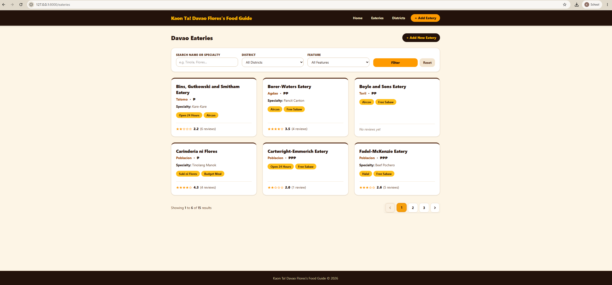
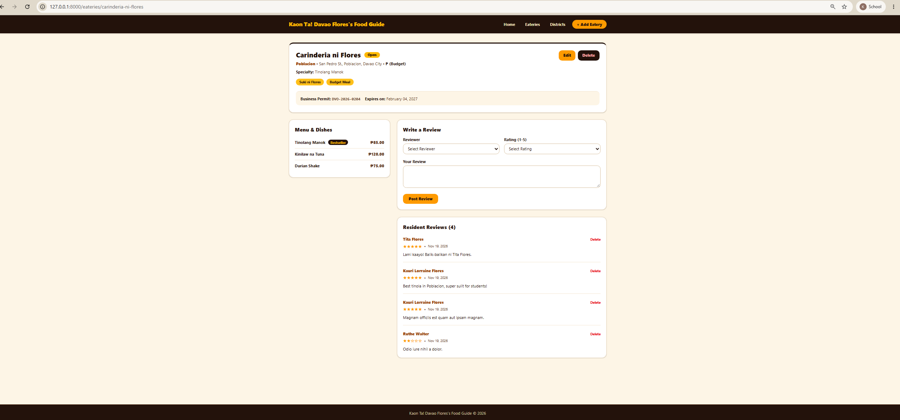
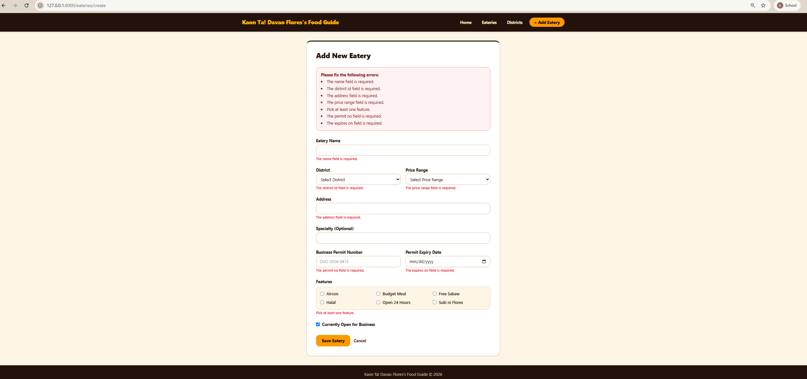

# Kaon Ta! Davao Flores's Food Guide

**Student Name:** Kauri Lorraine Flores  
**Course:** CS Elective 2 — Full-Stack Development (Laravel)  
**Repository:** `PrefinalProject-Flores-KaonTaDavao`

---

## Setup Commands

```bash
composer install
cp .env.example .env
php artisan key:generate
touch database/database.sqlite
php artisan migrate:fresh --seed
npm install
npm run build
php artisan serve
```

---

## Personalized Data

* **Districts (6):** Poblacion, Talomo, Agdao, Buhangin, Toril, Tugbok
* **Features (6):** Suki ni Flores, Budget Meal, Halal, Open 24 Hours, Aircon, Free Sabaw
* **Seeded Users:**
  * `Kauri Lorraine Flores` (`flores@kaonta.test`)
  * `Tita Flores` (`tita.flores@kaonta.test`)
* **Hand-Made Eatery:** `Carinderia ni Flores` (slug: `carinderia-ni-flores`)
* **Permit Number:** `DVO-2026-0204` (expires `2027-02-04`)

---

## Eloquent Relationships

| Relationship | Type | Why This Type Fits |
| :--- | :--- | :--- |
| District → Eatery | `hasMany` / `belongsTo` | One district in Davao contains many eateries, while each eatery is located in one specific district. |
| Eatery → Dish | `hasMany` / `belongsTo` | An eatery serves multiple dishes on its menu, and each dish belongs to the single eatery that prepares it. |
| Eatery → Review | `hasMany` / `belongsTo` | Customers can leave many reviews for one eatery, and every review is written about one specific eatery. |
| User → Review | `hasMany` / `belongsTo` | A resident can write many reviews across different eateries, while each review has one author. |
| Eatery ↔ Feature | `belongsToMany` / `belongsToMany` | An eatery can offer many features (like Halal and Budget Meal), and each feature applies to many eateries through the `eatery_feature` pivot table. |
| Eatery → Permit | `hasOne` / `belongsTo` | Each eatery holds exactly one official business permit, and that permit belongs to that single eatery. |
| District → Review | `hasManyThrough` | A district collects all resident reviews indirectly through the eateries located within that district. |

---

## Route List (`php artisan route:list --except-vendor`)

```text
  GET|HEAD        / .................................................................................................................................... home › HomeController
  GET|HEAD        districts ....................................................................................................... districts.index › DistrictController@index
  GET|HEAD        districts/{district} .............................................................................................. districts.show › DistrictController@show
  GET|HEAD        eateries ........................................................................................................... eateries.index › EateryController@index
  POST            eateries ........................................................................................................... eateries.store › EateryController@store
  GET|HEAD        eateries/create .................................................................................................. eateries.create › EateryController@create
  GET|HEAD        eateries/{eatery} .................................................................................................... eateries.show › EateryController@show
  PUT|PATCH       eateries/{eatery} ................................................................................................ eateries.update › EateryController@update
  DELETE          eateries/{eatery} .............................................................................................. eateries.destroy › EateryController@destroy
  GET|HEAD        eateries/{eatery}/edit ............................................................................................... eateries.edit › EateryController@edit
  POST            eateries/{eatery}/reviews .................................................................................. eateries.reviews.store › ReviewController@store
  GET|HEAD        reviewers/{user} .................................................................................................. reviewers.show › ReviewerController@show
  DELETE          reviews/{review} ................................................................................................ reviews.destroy › ReviewController@destroy
```

---

## Screenshots

### 1. Eatery List (`/eateries`)


### 2. Eatery Page with Reviews (`/eateries/carinderia-ni-flores`)


### 3. Create Form Validation Errors (`/eateries/create`)
